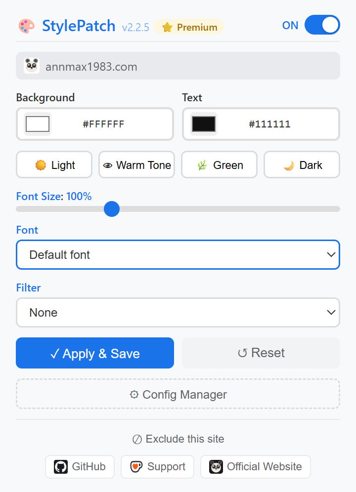

# StylePatch

Official User Manual · Multi-language: [English](README.md) | [中文](languages/README_zh.md) | [Español](languages/README_es.md) | [Deutsch](languages/README_de.md) | [日本語](languages/README_ja.md) | [Français](languages/README_fr.md)

> This document is the official user manual for StylePatch, accessible via the "User Manual" button inside the extension panel.

A lightweight browser extension that lets you customize any webpage's background color, text color, link color, font, page zoom and theme presets instantly for a more comfortable reading experience.

✅ Officially released on the Chrome Web Store, Microsoft Edge Add-ons and Firefox Add-ons · ✅ Zero tracking, data stored locally (cloud sync is optional and Pro) · ✅ Per-site independent settings

---

## Feature List

### 🆓 Free Features

| Feature | Description |
|---------|-------------|
| 🎨 **Background, Text & Link Color** | Pick any color via native color picker or type hex code directly; link color auto-adjusts for readability |
| 🔠 **Page Zoom** | Scale the whole page from 80% to 150% |
| 🔤 **Font Family** | Switch the page font — system fonts, or Google Fonts loaded from the web (Roboto, Open Sans, Noto Sans SC…) |
| 👁️ **Preset Themes** | Light, Warm Tone, Green, Ivory, Dark, Sepia, Night Blue, High Contrast — one click to apply |
| 🧭 **Contrast Hint** | Warns when text or link color falls below WCAG contrast thresholds |
| 🔄 **Global Toggle** | Enable/disable the extension globally without losing settings |
| 🚫 **Site Blacklist** | Exclude specific websites from styling |
| 💾 **Per-Site Settings** | Save different styles for different websites, auto-restore on revisit (up to 5 sites free) |
| 📤 **Local Backup** | Export all configurations to JSON and restore them later (free import is capped at 5 sites) |
| ⚡ **Real-Time Preview** | All changes apply instantly as you drag, no page reload needed |
| 🌍 **Multi-Language UI** | Supports English, Chinese, Spanish, German, Japanese, French |
| 🔒 **Minimal Permissions** | Only `storage`, `scripting`, `alarms` + `host_permissions` — no unnecessary access |
| 🏗️ **Manifest V3** | Built on Manifest V3 — service worker on Chrome / Edge, non-persistent background page on Firefox |
| 🔄 **One-Click Reset** | Drop the site's own config; falls back to your default theme when one exists |

### ⭐ Pro Features (License Required)

| Feature | Description |
|---------|-------------|
| ♾️ **Unlimited Configs** | Save styles for unlimited websites (free tier: 5 sites max) |
| ☁️ **Cloud Sync** | Keep site configs, the blacklist, the on/off toggle and your default theme in sync across profiles signed in to the same browser account — Chrome, Edge or Firefox (no backend, uses the browser's own `storage.sync`) |
| 🎨 **Default Theme** | Apply one global theme to every site without its own config; reset falls back to it |
| 📥 **Full Restore** | Import backups larger than 5 sites, including your default theme |
| 🌙 **Scheduled Switch** | Apply the built-in dark theme to every site between two times you choose (e.g. 19:00–07:00), automatically |

> See [VKT Pricing](https://annmax1983.com/pricing.html) for license options.

---

## Preview

  

---

## Supported Browsers

| Browser | Status | Minimum Version |
|---------|--------|-----------------|
| Google Chrome | ✅ Fully supported | Chrome 95+ |
| Microsoft Edge | ✅ Fully supported | Edge 95+ |
| Mozilla Firefox | ✅ Fully supported | Firefox 140+ (desktop) |
| Other Chromium-based browsers | ✅ Basic compatible | Install via official extension store only |

> **Firefox note:** colours, page zoom, font family, presets, contrast hints, blacklist, per-site configs, backups and the default theme all work the same way. Two platform details: Firefox has no service worker for extensions, so StylePatch runs on an event page there, and Pro Cloud Sync uses **Firefox Sync** instead of Chrome / Edge Sync (sign in to your Mozilla account to use it).

---

## Installation

| Store | Link |
|---|---|
| Chrome Web Store | [Install for Chrome](https://chromewebstore.google.com/detail/hlmnodnjlhdecfcaiahnngpldkialkca) |
| Microsoft Edge Add-ons | [Install for Edge](https://microsoftedge.microsoft.com/addons/detail/lkhpdpimlelcldbnkhggfdoejcimcfgo) |
| Firefox Add-ons (AMO) | [Install for Firefox](https://addons.mozilla.org/firefox/addon/stylepatch/) |

> Install only from the official stores above — avoid third-party download sites.

---

## Usage

1. Click the **StylePatch icon** in your browser toolbar
2. **Pick colors** — Use the native color picker or type a hex code
3. **Choose a preset** — Light, Warm Tone, Green, Ivory, Dark, Sepia, Night Blue, or High Contrast
4. **Adjust page zoom** — Drag the slider from 80% to 150% (this scales the whole page)
5. **Choose a font** — Pick a system font, or load a Google Font from the web
6. **Save** — Click **Apply & Save** to persist settings for this site
7. **Reset** — Click ↺ to remove the site's own config; with a default theme saved, the site falls back to it
8. **Set as default** — Pro users can save the current colors as the default theme for every site (sites with their own config keep it)
9. **Exclude** — Click "Exclude this site" to blacklist a domain
10. **Toggle** — Use the ON/OFF switch to disable without losing settings

### Config Manager

Click **⚙ Config Manager** in the top-right corner of the popup header to open the configuration page:

- **View**, search and **delete** configured sites with their color and font settings
- **Manage exclusions** — add a domain by hand, or drop one without going back to that site
- **Export** all configurations as a JSON backup file (free)
- **Import** a backup file to restore settings on another device or after reinstalling (free imports are capped at 5 sites)
- **Cloud Sync** (Pro) — mirror configs across profiles signed in to the same browser account (Chrome / Edge / Firefox)
- **Default Theme** (Pro) — review or remove the theme applied to sites without their own config
- **Scheduled Switch** (Pro) — set the dark-mode window and turn it on or off

---

## FAQ

1. **Styles don't take effect after adjustment?**
   Close other similar extensions (dark mode / eye-care) that may conflict, then refresh the page.

1. **Saved settings disappear after reopening the browser?**
   Make sure you clicked "Apply & Save". If using incognito / private windows, allow StylePatch to run there — Chrome / Edge: *Extension details → Allow in incognito*; Firefox: *about:addons → StylePatch → Run in Private Windows → Allow*.

1. **How do I transfer my settings to a new device?**
   Open Config Manager (⚙), click Export to download a backup file, then Import it on the new device. Free imports restore up to 5 sites; Pro restores everything. Within the same browser account (Chrome / Edge / Firefox), Pro users can also enable Cloud Sync and skip the file entirely.

1. **Why do `www.example.com` and `example.com` share the same settings?**
   That's intentional — domains are matched regardless of the leading `www.`, so your style applies consistently on both addresses.

1. **Can't find StylePatch on the extension store?**
   Check your network region. You can find the official store link at [www.annmax1983.com](https://www.annmax1983.com).

---

## Privacy

StylePatch follows privacy-by-design principles and collects zero user data:

1. **Permissions requested** — only four:
   - `storage`: Saves your custom colors, font size, site blacklist and theme preferences. Local data uses the extension's local storage (`storage.local`); the optional Pro Cloud Sync uses the browser's sync storage (`storage.sync`) — the same permission on every supported browser.
   - `scripting`: Used only to inject the generated CSS into the current tab (in the extension's isolated world). It does not read page content or execute remote code.
   - `alarms`: Used only to wake the service worker at the scheduled dark-mode boundary. No data is involved and nothing polls in the background.
   - `host_permissions`: Only used to inject custom CSS styles to adjust page appearance. Does not read DOM text, images, cookies, login credentials or form data.

1. **No tracking** — No browsing history access, no embedded third-party trackers, no analytics.

1. **Data stays local unless you opt in** — Configuration data exists on your device by default. Data leaves your browser only when you:
   - manually export a backup file;
   - enable Cloud Sync (Pro), which stores only site configs, the blacklist, the on/off toggle and the default theme in your browser account via the browser's `storage.sync` — never license keys or browsing data;
   - pick a Google Font (the font file is downloaded from fonts.googleapis.com);
   - activate or validate a license (the license key, a random install ID and basic browser metadata are sent to `api.annmax1983.com`).

- [Full Privacy Policy](https://annmax1983.github.io/StylePatch/privacy-policy.html)
- [Supplementary Privacy Details](https://www.annmax1983.com)

---

## Copyright Disclaimer

1. This extension only locally adjusts the visual rendering style of web pages for comfortable reading. All text, images and content copyright of each website belong to its respective publisher.
2. Modifying page display styles does not grant users any copyright authorization of website content. Users are strictly prohibited from using this extension to bypass website paywalls, membership restrictions, or anti-copy protection mechanisms.
3. Users shall comply with local laws and platform terms of service when using this extension. Any illegal use shall be borne by the user.

---

## Source Code Notice

> ⚠️ **This repository is for project showcase only — the full source code is not published here.** It contains the user documentation, release notes and support information for the extension.

> 📥 **Download and install only from the official browser stores:** Chrome Web Store · Microsoft Edge Add-ons · Firefox Add-ons (AMO). No offline installation package is distributed from this repository.

---

## License

Copyright © 2026 StylePatch. All rights reserved.

This software is closed-source proprietary software. Without official written authorization, the following are strictly prohibited:
- Decompiling, cracking, or modifying the program code
- Repackaging, redistribution, sharing, or commercial resale
- Embedding the program into other software for bundled distribution

Violators will bear corresponding legal liabilities.

---

## ❤️ Support

If you find StylePatch helpful, consider buying the developer a coffee!

**[👉 Click here to support](https://ko-fi.com/annmax?buyACoffee=true&ref=stylepatch)**

---

## Links

- **Official website:** https://annmax1983.com/
- **This extension:** https://annmax1983.com/extensions/stylepatch
- **Privacy policy:** https://annmax1983.com/privacy
- **Contact:** support@annmax1983.com
- **☕ Support this project (Ko-fi):** https://ko-fi.com/annmax?ref=stylepatch
