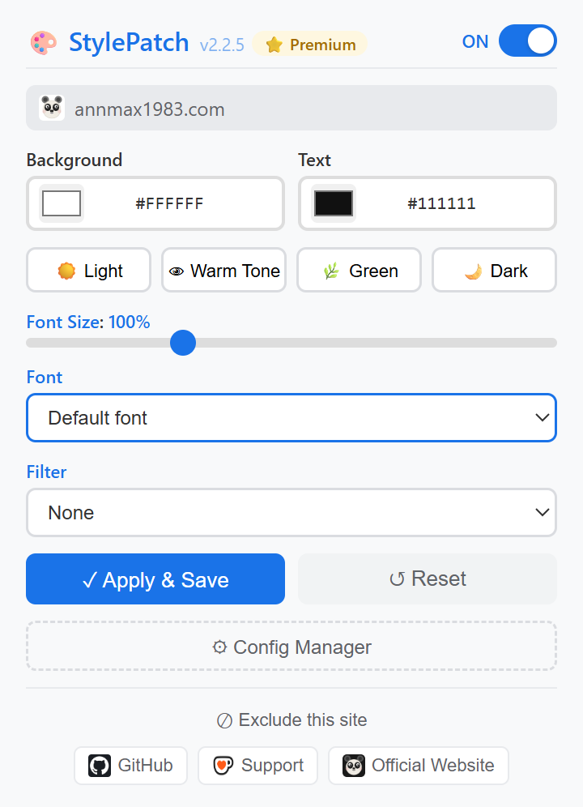

# StylePatch

公式ユーザーマニュアル · 多言語対応：[English](../README.md) | [中文](README_zh.md) | [Español](README_es.md) | [Deutsch](README_de.md) | 日本語 | [Français](README_fr.md)

> このドキュメントはStylePatchの公式ユーザーマニュリアルです。拡張機能パネル内の「ユーザーマニュアル」ボタンからアクセスできます。

任意のWebページの背景色・テキスト色・リンク色・フォント・フィルタ効果・フォントサイズを瞬時にカスタマイズできる軽量ブラウザ拡張機能です。より快適な読書体験を実現します。

✅ Chrome・Edge Web Storeで公式リリース済み · ✅ トラッキングゼロ、データはローカル保存（クラウド同期は任意のPremium機能） · ✅ サイトごとの個別設定

---

## 機能一覧

### 🆓 無料機能

| 機能 | 説明 |
|---------|-------------|
| 🎨 **背景色・テキスト色・リンク色** | ネイティブカラーピッカーで任意の色を選択、または16進数コードを直接入力。リンク色は読みやすさを考慮して自動調整されます |
| 🔠 **フォントサイズ拡大縮小** | CSS zoomで80%〜150%に調整 |
| 🔤 **フォントファミリー** | ページのフォントを切り替え — システムフォント、またはWebから読み込むGoogle Fonts（Roboto、Open Sans、Noto Sans SCなど） |
| 🌗 **カラーフィルター** | グレースケールモードと暖色セピア調の護眼モード |
| 👁️ **プリセットテーマ** | ライト、暖色、グリーン、ダーク、セピア、ブルーナイト、ハイコントラスト — ワンクリックで適用 |
| 🧭 **コントラスト警告** | テキストやリンクの色がWCAGのコントラスト基準を下回ると通知します |
| 🔄 **グローバルトグル** | 設定を失うことなく、拡張機能をグローバルにON/OFF |
| 🚫 **サイトブラックリスト** | 特定のWebサイトをスタイリングから除外 |
| 💾 **サイト別設定** | 異なるWebサイトに異なるスタイルを保存し、再訪問時に自動復元（無料版は最大5サイト） |
| 📤 **ローカルバックアップ** | すべての設定をJSONにエクスポートしていつでも復元（無料版のインポートは最大5サイト） |
| ⚡ **リアルタイムプレビュー** | ドラッグ中にすべての変更が即座に適用されます。ページの再読み込みは不要です |
| 🌍 **多言語UI** | 英語、中国語、スペイン語、ドイツ語、日本語、フランス語に対応 |
| 🔒 **最小限の権限** | `storage`＋`scripting`＋`host_permissions`のみ — 不要なアクセスなし |
| 🏗️ **Manifest V3** | Manifest V3 Service Workerアーキテクチャで構築 |
| 🔄 **ワンクリックリセット** | サイト独自の設定を削除。デフォルトテーマがあればそれに戻ります |

### ⭐ Premium機能（ライセンス必要）

| 機能 | 説明 |
|---------|-------------|
| ♾️ **無制限の設定** | 無制限のWebサイトにスタイルを保存（無料版は最大5サイト） |
| ☁️ **クラウド同期** | 同じブラウザアカウントでサインインしたChrome/Edgeプロファイル間で、サイト設定・ブラックリスト・ON/OFF状態・デフォルトテーマを同期（バックエンド不要、`chrome.storage.sync`を使用） |
| 🎨 **デフォルトテーマ** | 独自設定のないすべてのサイトに共通テーマを適用。リセット時はこのテーマに戻ります |
| 📥 **完全復元** | 5サイトを超えるバックアップをデフォルトテーマ込みでインポート |

> ライセンスオプションについては[VKT Pricing](https://annmax1983.com/pricing.html)をご覧ください。

---

## プレビュー

  

---

## 対応ブラウザ

| ブラウザ | ステータス | 最低バージョン |
|---------|--------|-----------------|
| Google Chrome | ✅ 完全対応 | Chrome 95+ |
| Microsoft Edge | ✅ 完全対応 | Edge 95+ |
| その他のChromium系ブラウザ | ✅ 基本対応 | 公式拡張機能ストアからのインストールのみ |

---

## インストール

| ストア | リンク |
|---|---|
| Chrome ウェブストア | [Chrome に追加](https://chromewebstore.google.com/detail/hlmnodnjlhdecfcaiahnngpldkialkca) |
| Microsoft Edge アドオン | [Edge に追加](https://microsoftedge.microsoft.com/addons/detail/lkhpdpimlelcldbnkhggfdoejcimcfgo) |

> 上記の公式ストアからのみインストールしてください。第三者サイトの利用は避けてください。

---

## 使い方

1. ブラウザツールバーの**StylePatchアイコン**をクリックします
2. **色を選択** — ネイティブカラーピッカーを使用するか、16進数コードを入力します
3. **プリセットを選択** — ライト、暖色、グリーン、ダーク、セピア、ブルーナイト、ハイコントラストから選択
4. **フォントサイズを調整** — スライダーを80%〜150%の間でドラッグ
5. **フォントを選択** — システムフォントを選ぶか、WebからGoogle Fontsを読み込みます
6. **フィルターを適用** — オプションでグレースケールまたは暖色護眼フィルターを適用
7. **保存** — **適用して保存**をクリックして、このサイトの設定を永続化します
8. **リセット** — ↺をクリックしてサイト独自の設定を削除。デフォルトテーマがあればそれに戻ります
9. **デフォルトに設定** — Premiumユーザーは現在の配色をすべてのサイトのデフォルトテーマとして保存できます（独自設定のあるサイトはそのまま）
10. **除外** — 「このサイトを除外」をクリックしてドメインをブラックリストに追加
11. **トグル** — ON/OFFスイッチで設定を失うことなく無効化

### 設定マネージャー

ポップアップ下部の**⚙ 設定マネージャー**をクリックして設定ページを開きます：

- 設定済みのサイトとその色・フォント設定を**表示**・検索・**削除**
- すべての設定をJSONバックアップファイルとして**エクスポート**（無料）
- バックアップファイルを**インポート**して、別のデバイスまたは再インストール後に設定を復元（無料版は最大5サイト）
- **クラウド同期**（Premium）— 同じブラウザアカウントのChrome/Edgeプロファイル間で設定を複製
- **デフォルトテーマ**（Premium）— 独自設定のないサイトに適用されるテーマを確認・削除

---

## よくある質問

1. **調整後にスタイルが適用されない？**
   他の類似拡張機能（ダークモード／護眼モード）を閉じて、ページを再読み込みしてください。

2. **ブラウザ再起動後に保存した設定が消える？**
   「適用して保存」をクリックしたことを確認してください。シークレットモードを使用している場合は、プライベートウィンドウでのStylePatch権限を有効にしてください。

3. **新しいデバイスに設定を移行するには？**
   設定マネージャー（⚙）を開き、エクスポートをクリックしてバックアップファイルをダウンロードし、新しいデバイスでインポートしてください。無料版のインポートは最大5サイト、Premiumはすべて復元します。同じChrome/Edgeアカウント内であれば、Premiumユーザーはクラウド同期を有効にしてファイルを使わずに移行することもできます。

4. **`www.example.com`と`example.com`が同じ設定を共有するのはなぜ？**
   これは仕様です。ドメインは先頭の`www.`に関係なく一致するため、両方のアドレスでスタイルが一貫して適用されます。

5. **拡張機能ストアでStylePatchが見つからない？**
   ご利用のネットワーク地域をご確認ください。公式ストアのリンクは[www.annmax1983.com](https://www.annmax1983.com)で確認できます。

---

## プライバシー

StylePatchはプライバシー・バイ・デザインの原則に従い、ユーザーデータを一切収集しません：

1. **要求する権限** — 3つのみ：
   - `storage`：カスタムカラー、フォントサイズ、サイトブラックリスト、テーマ設定をローカルに保存します。任意のPremiumクラウド同期は`chrome.storage.sync`を使用します。Webページのコンテンツは保存されません。
   - `scripting`：生成したCSSを現在のタブ（拡張機能の分離ワールド）に注入するためだけに使用されます。ページ内容の読み取りやリモートコードの実行は行いません。
   - `host_permissions`：カスタムCSSスタイルを注入してページの外観を調整するためにのみ使用されます。DOMテキスト、画像、Cookie、ログイン資格情報、フォームデータは読み取りません。

2. **トラッキングなし** — 閲覧履歴へのアクセス、サードパーティトラッカーの埋め込み、アナリティクスはありません。

3. **データは明示しない限りローカルに保存** — 設定データはデフォルトでデバイス上に存在します。データがブラウザの外に出るのは次の場合のみです：
   - バックアップファイルを手動でエクスポートした場合；
   - クラウド同期（Premium）を有効にした場合：サイト設定、ブラックリスト、ON/OFF状態、デフォルトテーマのみを`chrome.storage.sync`経由でブラウザアカウントに保存し、ライセンスキーや閲覧データは同期しません；
   - Google Fontを選択した場合（フォントファイルはfonts.googleapis.comからダウンロードされます）；
   - ライセンスをアクティベートまたは検証した場合（ライセンスキー、ランダムなインストールID、基本的なブラウザ情報がapi.annmax1983.comに送信されます）。

- [プライバシーポリシー全文](https://annmax1983.github.io/StylePatch/privacy-policy.html)
- [プライバシー補足事項](https://www.annmax1983.com)

---

## 著作権に関する免責事項

1. この拡張機能は、快適な閲覧のためにWebページの視覚的なレンダリングスタイルをローカルで調整するだけです。各Webサイトのすべてのテキスト、画像、コンテンツの著作権は、それぞれの発行者に帰属します。
2. ページの表示スタイルを変更しても、ユーザーにWebサイトコンテンツの著作権が付与されるものではありません。この拡張機能を使用してWebサイトのペイウォール、メンバーシップ制限、またはコピープロテクションを回避することは固く禁じられています。
3. ユーザーはこの拡張機能の使用時に、現地の法律とプラットフォームの利用規約に従うものとします。違法な使用により生じる責任はすべてユーザーが負うものとします。

---

## ソースコードに関する注意

> ⚠️ **このリポジトリにはソースコードは公開されていません。** 使用ドキュメント、リリースノート、サポートリソースのみを含みます。拡張機能はChrome Web Storeを通じてのみ配布されます。オフラインインストールパッケージやエンドユーザー向けソースコードは提供されません。

---

## ライセンス

Copyright © 2026 StylePatch. All rights reserved.

本ソフトウェアはクローズドソースのプロプライエタリソフトウェアです。公式の書面による許可なく、以下の行為は固く禁じられています：
- プログラムコードの逆コンパイル、クラッキング、改変
- 再パッケージ、再配布、共有、商業的な再販
- 他のソフトウェアに組み込んでバンドル配布

違反者は対応する法的責任を負います。

---

## ❤️ サポート

StylePatchが役に立った場合は、開発者にコーヒーをおごってあげてください！

**[👉 こちらから支援する](https://ko-fi.com/annmax?buyACoffee=true&ref=stylepatch)**
